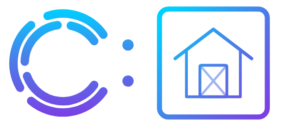

<p align="center">
  
</p>

<h4 align="center">Vetted, sandboxed apps for agents. Built for builders.</h4>

<p align="center">
  <a href="https://clagentic.ai"></a>
  <a href="LICENSE"></a>
  
  <a href="https://ko-fi.com/clagentic"></a>
</p>

clagentic: toolshed is a vetted, sandboxed, self-updating registry of agent-drivable apps (CLI or
MCP). Install an app once; agents then run it as an MCP server inside a locked-down container.
Part of the [clagentic](https://clagentic.ai) suite. Standalone: it needs no other clagentic product.

## What it does

- **Catalog.** Tracks every app a configured source offers, installed or not, with its latest version
  and whether its release passes the checks. Refreshes automatically. Discovery reads metadata and
  small signed checksum files only; it never downloads or runs an app.
- **Vetting.** A release is only installable if its checksum list is signed by the primary key
  fingerprint pinned in your config, and the archive matches that list. URLs are built from the pinned
  org plus a validated slug and tag, never taken from page content, so lookalike repos are never
  followed.
- **Sandbox.** Apps run with no network, read-only root filesystem, all capabilities dropped,
  `no-new-privileges`, non-root uid, memory and pid limits, and exactly three mounts: the app
  directory and an input directory, both read-only, and a writable output directory. The app binary
  is re-hashed against its vetted hash before every run, probe, approve and rollback.
- **Updates.** `clagentic-toolshed update` stages newer versions of installed apps, runs an MCP probe
  in the sandbox, and compares the tool surface (names and input schemas) with the current version.
  Unchanged surface, same signer, same repo: promoted automatically. Anything else is held for
  `clagentic-toolshed approve`. The previous version is kept for `clagentic-toolshed rollback`, and
  a rolled-back version is not re-promoted automatically.
- **Fails safe.** A failed download, bad signature or failed probe leaves the installed version
  untouched. A source that is temporarily unreachable or rate limited keeps its last known catalog
  entries; only a release that actually fails a check is marked `flagged`.

## Install

Requires Python 3.11.4+, `gpg`, and a Docker daemon (local, or remote via `runtime.docker_host`;
agents' files must be reachable from that daemon). The user that runs `clagentic-toolshed`,
including the one the update timer runs as, needs access to that daemon.

```bash
pip install .                         # or run bin/clagentic-toolshed straight from the checkout
mkdir -p ~/.config/clagentic/toolshed
cp config.example.toml ~/.config/clagentic/toolshed/config.toml   # then edit
clagentic-toolshed catalog --refresh
clagentic-toolshed install <app>
sudo deploy/install-timer.sh          # optional: daily update via systemd, runs as you
```

Verify the signing-key fingerprint in the config against more than one official location before
pinning it (`config.example.toml` lists where ArtCraft publishes theirs: its website and the
release assets).

The catalog uses the GitHub API, which allows 60 unauthenticated requests per hour; one refresh
costs about one request per app. Set `CLAGENTIC_TOOLSHED_GITHUB_TOKEN` (a token with no scopes is
enough) to raise that; it is sent only to the source's API host, and a bare `GITHUB_TOKEN` is never
read. For the timer, put `CLAGENTIC_TOOLSHED_GITHUB_TOKEN=...` in `/etc/clagentic/toolshed/env`
(mode 600).

| What | Default | Override |
|---|---|---|
| Config file | `~/.config/clagentic/toolshed/config.toml` | `CLAGENTIC_TOOLSHED_CONFIG`, `--config` |
| Data (state, apps, io roots) | `~/.local/share/clagentic/toolshed` | `CLAGENTIC_TOOLSHED_HOME` |

Nothing is written into the repo.

Without `--read` / `--write`, `run` uses `<data>/io/<app>/in` and `<data>/io/<app>/out`. The out
directory is mode 0777 so the container's unprivileged uid can write to it, which means any local
user can write there too; pass your own `--write` directory where that matters. A root that equals,
contains or sits inside the data directory (other than the app's own `io/<app>` directory) or the
config directory is refused, as is a path containing `:` or `,`.

## Use

```bash
clagentic-toolshed list                                 # available / installed / held / flagged
clagentic-toolshed run <app> --read DIR --write DIR     # MCP server on stdio (what an MCP client launches)
claude mcp add --scope project <app> -- clagentic-toolshed run <app> --read DIR --write DIR
clagentic-toolshed update [--dry-run]                   # refresh catalog, stage and promote/hold updates
clagentic-toolshed approve <app>                        # promote a held update
clagentic-toolshed rollback <app>                       # make the previous version current again
clagentic-toolshed install <app> --force                # re-download and re-vet an installed version
clagentic-toolshed probe <app>                          # re-run the sandbox probe
clagentic-toolshed gc                                   # remove stopped containers
```

`skills/clagentic-toolshed/SKILL.md` is an agent-facing skill describing this workflow.

## Sources and extending beyond one vendor

A source is a `[source.<name>]` table whose `type` selects a source type. The one built in,
`github-org-directory`, expects a directory page linking `/<path>/<slug>`, one repo per slug in a
GitHub org, and releases carrying a platform tarball plus a GPG-signed checksum list. Every release
convention is configurable per source (asset names, archive layout, CLI path, MCP launch
arguments); see `config.example.toml`. Multiple sources can coexist; a slug offered by more than one
is taken from the first source in the config, and the overlap is reported.

To add a vendor that publishes differently, subclass `SourceType` in
`src/clagentic_toolshed/sources.py` and register it. A type implements three methods: `discover`
(which slugs exist), `describe` (one slug's latest release, as a catalog entry), and `release_url`
(where its assets live). Vetting, staging, the sandbox and the update policy are shared, and
`tests/test_lifecycle.py` drives the whole lifecycle through a fake type you can copy.

Not covered yet: signature schemes other than a GPG-signed checksum list (for example cosign-signed
OCI images).

## Example source: ArtCraft

`config.example.toml` is preconfigured for ArtCraft, the source clagentic: toolshed is first used
with: the apps listed at [getartcraft.com/apps](https://getartcraft.com/apps), released from the
[storytold](https://github.com/storytold) GitHub org. These four apps launch with the example
`run_args` (`mcp --automation-read-root DIR --automation-write-root DIR`) and publish the release
assets the vetting step needs:

| App | What it does | Formats | Repo |
|---|---|---|---|
| WordCraft | Fast, open-source word processing, rebuilt in pure Rust. | DOCX read/write; ODT, RTF, HTML, MD, TeX, TXT import/export; PDF export | [storytold/wordcraft](https://github.com/storytold/wordcraft) |
| DeckCraft | Build and deliver dynamic slide presentations, in pure Rust. | PPTX open/save; PDF and PNG/JPEG export | [storytold/deckcraft](https://github.com/storytold/deckcraft) |
| SoundCraft | Professional audio recording, editing and mixing in pure Rust. | WAV/BWF/RF64, AIFF/AIFC, FLAC in and out; MP3, Ogg Vorbis, AAC, ALAC, CAF in | [storytold/soundcraft](https://github.com/storytold/soundcraft) |
| VectorCraft | Fast, open-source vector illustration, reimagined in pure Rust. | SVG, PDF (and PDF-compatible .ai) import/export | [storytold/vectorcraft](https://github.com/storytold/vectorcraft) |

The directory lists more apps. Only these four have been checked against this config. An app that
names its MCP flags differently needs its own launch arguments, which a source does not support yet
(`run_args` is per source, not per app). ArtCraft is an example, not a dependency: any source that
fits the layout above works the same way.

## Threat model

Defends against: lookalike repos and mirrors, tampered or unsigned releases, silent tool-surface
changes in updates, and a malicious or exploited app binary reaching the network, the host filesystem
or other containers. Does not defend against: prompt injection through the content of documents an
agent opens, a compromised upstream signing key, or kernel/container-runtime escapes. On hosts where
Docker cannot enforce AppArmor, set `runtime.extra_security_opts` accordingly and treat the container
boundary as weaker; every command then prints a warning.

The default `runtime.base_image` is a tag, which its publisher can re-point. Pin it by digest
(`debian:bookworm-slim@sha256:...`) so the image an app runs in is the one you checked.

## Tests

```bash
python3 -m unittest discover -s tests -t .
```

## Support

If clagentic: toolshed is useful to you: [ko-fi.com/clagentic](https://ko-fi.com/clagentic)

## Disclaimer

Not affiliated with Anthropic or OpenAI. Claude is a trademark of Anthropic. Codex is a
trademark of OpenAI. Provided "as is" without warranty. Users are responsible for
complying with their AI provider's terms of service.

## License

[FSL-1.1-MIT](LICENSE) — Functional Source License 1.1, with MIT as the Change License.

Free for personal, internal-business, evaluation, research, and non-commercial use.
Not free for offering this tool (or a substantial fork) as a competing commercial product.
Each release auto-converts to MIT on its second anniversary.
